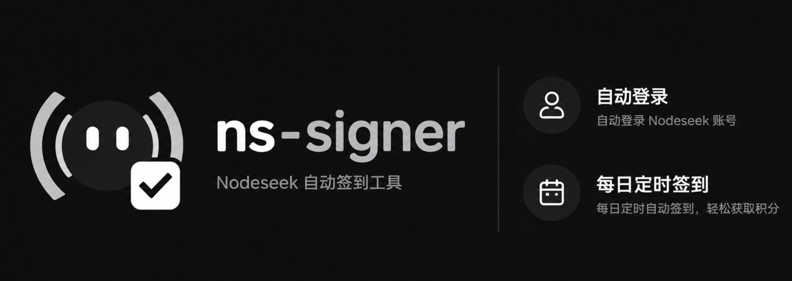

<div style="display: flex; justify-content: center;">
  
</div>

<div style="display: flex; justify-content: center;">
  <a href="https://github.com/DotRacel/ns-signer/actions/workflows/docker-image.yml">
    
  </a>
</div>

<h1 align="center">Nodeseek 每日自动签到工具</h1>

## 功能

- 支持定时每日签到。
- 支持固定 5 鸡腿或随机鸡腿模式。
- 支持签到前随机延迟。
- 自动处理 Cloudflare Turnstile 验证。

由于官方 TG Bot 会在签到成功后自动提醒，所以暂时没打算做提醒模块。

## 部署方式

目前我们支持了 Docker Compose 部署.

### Docker Compose

创建 `compose.yaml`：

```yaml
services:
  ns-signer:
    image: ghcr.io/dotracel/ns-signer:latest
    container_name: ns-signer
    restart: unless-stopped
    environment:
      NODESEEK_USERNAME: your_username
      NODESEEK_PASSWORD: your_password
      ATTENDANCE_TIME: "09:00"
      RANDOM_DELAY_MAX: "0"
      ATTENDANCE_MODE: fixed
      TZ: Asia/Shanghai
    volumes:
      - ./data:/data
```

需要修改的配置：

- `NODESEEK_USERNAME`：Nodeseek 用户名或邮箱。
- `NODESEEK_PASSWORD`：Nodeseek 密码。
- `ATTENDANCE_TIME`：每日签到时间，24 小时制 `HH:MM`。
- `RANDOM_DELAY_MAX`：签到前最大随机延迟秒数，`0` 表示禁用。
- `ATTENDANCE_MODE`：`fixed` 表示固定 5 鸡腿，`random` 表示随机鸡腿。
- `TZ`：容器时区，建议设置为 `Asia/Shanghai`。

然后在该目录下输入 `docker compose up -d`

## 常用操作

手动执行一次签到：

```bash
docker compose run --rm ns-signer python -m ns_signer.main --once
```

强制重新登录并刷新 cookies：

```bash
docker compose run --rm ns-signer python -m ns_signer.main --login
```

注意：`--login` 是强制刷新登录态，不会复用已有 cookies。Docker Compose
部署时 cookies 保存在宿主机的 `./data/cookies.json`；本地直接运行 Python 时，
默认保存在项目根目录的 `cookies.json`。
